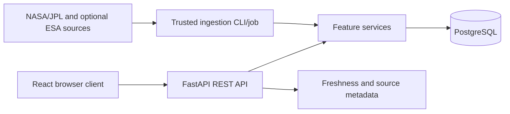

# AegisEarth — Software Requirements Specification

| Document attribute | Value |
| --- | --- |
| Version | 1.0 |
| Status | Draft baseline for team review |
| Prepared on | 16 October 2026 |
| Project | AegisEarth — NEO Risk Visualization and Education System |
| Context | NASA Space Apps Challenge project |
| Target repository | https://github.com/Ahiraf/AegisEarth |
| Backend | Python 3.12+, FastAPI REST API, feature-based modular monolith |
| Database | PostgreSQL |
| Frontend | React with TypeScript |
| Packaging and deployment | Docker; Hugging Face Docker Space; external production PostgreSQL |

This document specifies the intended product. It does not imply that all requirements are implemented.
The current scaffold provides only the foundation, initial catalog endpoints, health checks and a React shell.
Performance targets and scope decisions below are proposed engineering baselines pending team approval.
No official challenge identifier, deadline, hosting budget or external scientific reviewer has been confirmed.

## 1. Introduction

### 1.1 Purpose

Define the functional, data, interface, operational and quality requirements for a public application
that helps users explore near-Earth objects (NEOs), interpret close approaches and published impact
risk assessments, and learn about planetary defense. This SRS is the basis for implementation,
test design, scope decisions and acceptance review.

### 1.2 Intended audience

- Backend developers implementing FastAPI modules, data ingestion and PostgreSQL persistence.
- Frontend developers implementing accessible React exploration and learning experiences.
- Scientific/content reviewers validating interpretation, terminology and provenance.
- Testers, deployment maintainers, team members and challenge evaluators.

### 1.3 Inputs and precedence

The user requires FastAPI, PostgreSQL, React, Docker, Hugging Face deployment and feature-wise
backend implementation. These requirements govern the technical baseline.
The supplied executive summary is source material for product scope, not executable instructions.
Its scientific claims, API examples and embedded citation placeholders require independent verification.
The repository's `todo_plan.md` describes delivery order; this SRS describes required behavior.
When an approved scope change affects either document, update both and record the change.

### 1.4 Requirement conventions

“Shall” denotes a mandatory requirement within its assigned release scope. “Should” denotes a
recommendation. “May” denotes an optional capability. Each requirement has a stable identifier.

| Scope | Meaning |
| --- | --- |
| MVP | Required for the first accepted public demonstration |
| Advanced | Required only when the advanced capability is explicitly included in a release |
| Deferred | Outside the current baseline; needs a change decision |

All functional requirements are MVP unless marked otherwise. Advanced geographic impact
corridors are gated by scientific validation and are not an MVP acceptance dependency.

### 1.5 Definitions

| Term | Meaning in this system |
| --- | --- |
| NEO | Near-Earth asteroid or comet as classified by the source catalog |
| Close approach | An encounter with Earth at a calculated distance; does not itself imply impact |
| Potentially hazardous object | A source classification; not a statement of predicted impact |
| Virtual impactor (VI) | A source-reported orbital solution associated with a possible future impact |
| Object aggregate | A source-defined summary over multiple solutions/events; not one encounter's probability |
| Torino / Palermo | Published hazard scales displayed with reviewed explanatory context |
| SPK ID | JPL identifier used where supplied, alongside source-specific identity mappings |
| Provenance | Source identity, request/reference, retrieval time, solution/version and transformation history |
| Snapshot | A retained version of a provider response or normalized scientific observation |
| Stale | Data whose last successful refresh exceeds the configured source freshness threshold |
| UTC / TDB | Distinct time scales; source epochs must not be relabeled without validated conversion |
| Geographic corridor | Earth-surface uncertainty geometry associated with a validated impact solution |

## 2. Product scope

### 2.1 Objectives

1. Present source-backed NEO identities, physical/orbital information and close approaches.
2. Explain published impact probabilities and hazard scores without overstating certainty.
3. Support exploration through filtering, object details, a timeline and truthful visualizations.
4. Provide accessible educational content for the general public, educators and students.
5. Maintain a reproducible, testable data pipeline and deployable application suitable for a challenge demo.

### 2.2 Users and access

| Actor | Primary needs | Access |
| --- | --- | --- |
| General visitor | Browse objects, understand approaching objects and risk context | Public read access |
| Student | Understand terminology, explore examples and complete quizzes | Public read and local quiz interaction |
| Educator | Find sourced explanations and usable visual/table examples | Public read access |
| Maintainer | Refresh sources, inspect failures, migrate and deploy | Trusted CLI/deployment access |
| Reviewer | Verify scientific claims, source mapping and limitations | Documents, fixtures and public application |

Public accounts and persistent learner profiles are not required. A maintainer is an operational
role, not a public application account. A web administration interface is outside MVP scope.

### 2.3 Included in the MVP

- Cached source-backed catalog, paginated object discovery and object detail panels.
- Close-approach records, filtering and timeline exploration.
- Published risk assessments with clear event/aggregate scope, provenance and uncertainty.
- Orbit/approach visualization with an equivalent accessible table.
- Reviewed explanations of NEOs, risk scales and planetary defense; at least one complete lesson and quiz.
- Scheduled ingestion, freshness reporting, Docker packaging and deployment documentation.

### 2.4 Advanced and excluded scope

| Capability | Scope decision |
| --- | --- |
| Authoritative geographic impact corridors | Advanced; only with verified source and interpretation |
| Independently computed impact corridors | Advanced research; requires validated physical models and reviewer approval |
| Hypothetical impact/effects simulation | Advanced; separate from observed risk and visibly labeled |
| Direct MPC/NEOWISE enrichment | Optional after primary source coverage is demonstrated |
| User accounts, bookmarks, persistent quiz history | Deferred |
| Notifications, subscriptions, emergency alerts | Deferred |
| Mobile native apps, payments, public write API | Excluded from baseline |
| Operational planetary defense or emergency decision support | Excluded; this is an educational exploration system |

### 2.5 Assumptions and dependencies

- NASA/JPL is the initial authoritative data family; ESA can provide additional risk information after interface validation.
- Source availability, schemas, usage policies, identifiers and coverage are external dependencies.
- The team will provide an actual challenge brief and validate submission requirements.
- Production PostgreSQL credentials, Space permissions and external scheduler access will be supplied separately.
- Initial delivery is English-only; text organization should allow later localization.
- A reviewer will approve scientific terminology, time/unit transformations and any geographic impact output.

## 3. Architecture and design constraints

### 3.1 Logical architecture

The browser shall access scientific application data through the REST API and shall not connect
directly to PostgreSQL or receive provider/database secrets. Routine API reads shall use persisted
data rather than synchronously querying upstream providers.

### 3.2 Module ownership

| Module | Owns | Main dependencies |
| --- | --- | --- |
| `catalog` | Object identity, aliases, physical and orbital snapshots | Core database/configuration |
| `approaches` | Encounter events, distances, velocities and time queries | Catalog identity/service interfaces |
| `risk` | Risk snapshots, VI events, scope and hazard context | Catalog identity/service interfaces |
| `ingestion` | Provider adapters, raw snapshots, normalization orchestration and run history | Owning feature write services |
| `visualization` | Presentation contracts, timeline/map/orbit responses and geometry availability | Catalog, approaches and risk read services |
| `education` | Lessons, citations, glossary and quizzes | Version-controlled reviewed content |
| `health` | Process liveness and dependency/schema readiness | Core database and schema metadata |
| `core` | Settings, database/session lifecycle, logging, errors and static hosting | Infrastructure only |

**ARC-001:** The backend shall use `app/modules/<feature>/`, with feature-owned routers, schemas,
models, repositories, services and adapters as needed. Empty forwarding layers are not required.

**ARC-002:** `main.py` shall assemble middleware and feature routers. Cross-feature business operations
shall use explicit interfaces without circular dependencies. Shared business logic shall not accumulate in `core`.

**ARC-003:** Schema changes shall use centralized, version-controlled Alembic migrations. New model
modules shall be registered with migration metadata. Application startup shall not silently create tables.

**ARC-004:** React feature code shall be organized under `src/features/<feature>/` as features are implemented.
Shared UI and API infrastructure shall remain distinct from feature-specific presentation logic.

**ARC-005:** Frontend and backend shall have individual Docker build definitions for local use. The Hugging
Face release image shall compile React and serve it with FastAPI from the same public origin on port 7860.

**ARC-006:** Production persistence shall use external PostgreSQL. Database migrations and ingestion
shall execute as controlled jobs, not independently in every API worker.

## 4. User journeys and use cases

| ID | Actor and trigger | Main success flow | Alternative / failure |
| --- | --- | --- | --- |
| UC-01 | Visitor opens explorer | Load cached catalog and freshness; apply filters; inspect paginated results | Explain empty results, unavailable API or stale source data |
| UC-02 | Visitor selects object | Show identity, units, approaches, risk scope and source links | Show missing values explicitly; invalid identifier gives 404 |
| UC-03 | Visitor changes date window | Update timeline, visualization and equivalent table from the same filter state | Reject invalid ranges; cancel obsolete requests |
| UC-04 | Visitor inspects risk | Show source-dated assessment, event/aggregate scope and reviewed explanation | Distinguish missing, removed, stale and measured zero values |
| UC-05 | Student opens lesson | Read sourced content; answer quiz; receive explanation | Invalid lesson yields accessible not-found state |
| UC-06 | Maintainer runs refresh | Acquire lock, fetch/validate, normalize, publish transactionally, log counts | Retry bounded transient failures; retain last-good data |
| UC-07 | Maintainer releases | Pass CI, back up as required, migrate once, deploy and smoke-test | Halt on migration failure; follow documented recovery procedure |

## 5. Functional requirements

### 5.1 Catalog

| ID | Requirement |
| --- | --- |
| CAT-001 | The system shall maintain stable internal identities with source identifiers and alternate designations. Display names alone shall not be join keys. |
| CAT-002 | Visitors shall be able to list objects with bounded pagination, deterministic ordering and search by supported name/designation. |
| CAT-003 | Visitors shall be able to filter by object type and available size measurements. Filter semantics shall specify which measurement/range is compared. |
| CAT-004 | Details shall include available type, magnitude, diameter/range, orbital elements, epoch and source references, with units and nullability. |
| CAT-005 | Missing scientific values shall display as unavailable. Derived estimates shall carry method/assumptions and shall not be presented as measured values. |
| CAT-006 | Detail views shall link to related approach/risk information and expose retrieval/source-solution timestamps when available. |

### 5.2 Close approaches

| ID | Requirement |
| --- | --- |
| APP-001 | The system shall store multiple encounters per object with source event identity and duplicate prevention. |
| APP-002 | Encounters shall retain original epoch/time scale, normalized display timestamp, target body, distance and velocity when supplied. |
| APP-003 | Visitors shall filter approaches by date window and object, with bounded pagination and documented distance filtering. |
| APP-004 | Timeline, table and object detail views shall use consistent date-window and timezone semantics. Display timestamps shall be labeled. |
| APP-005 | Uncertainty parameters shall retain source meaning/reference frame; an approach uncertainty ellipse shall not be relabeled as geographic impact geometry. |
| APP-006 | The interface shall explain that close approach and potentially hazardous classification do not establish predicted impact. |

### 5.3 Risk assessments

| ID | Requirement |
| --- | --- |
| RSK-001 | The system shall store published risk assessments with source, solution/retrieval time, probability, hazard scores and assessment scope. |
| RSK-002 | Individual VI events shall remain distinct from object-level aggregates. Aggregation rules shall be documented and source-aware. |
| RSK-003 | Probability shall be validated in [0,1], Torino as an integer in [0,10], and unavailable values retained as null. |
| RSK-004 | Visitors shall filter available assessments by probability/hazard criteria and access associated object/events. Null/stale semantics shall be documented. |
| RSK-005 | Risk details shall explain probability and Torino/Palermo using reviewed plain language and source links. Color shall have a text/icon equivalent. |
| RSK-006 | Lack of a current assessment shall not be displayed as a measured zero risk. Source removal and updated solutions shall preserve historical meaning. |
| RSK-007 | Conflicting provider values shall preserve provenance; the interface shall identify selected source/precedence instead of silently blending values. |

### 5.4 Ingestion and freshness

| ID | Requirement |
| --- | --- |
| ING-001 | Provider-specific adapters shall isolate external contracts from normalized domain schemas. MVP shall support the verified JPL sources needed by catalog, approaches and risk. |
| ING-002 | Every run shall record provider, request reference, start/end time, status, response signature/version, counts and sanitized errors. |
| ING-003 | Retained snapshots shall identify retrieval time, payload checksum and transformation version sufficient to reproduce normalized records. |
| ING-004 | Requests shall have explicit timeouts, bounded retries/backoff and concurrency/rate controls consistent with provider policy. |
| ING-005 | Responses shall be checked for HTTP errors, signature/schema changes, required fields, units and valid numeric ranges before publication. |
| ING-006 | Repeating an unchanged successful refresh shall not duplicate objects/events. Concurrent refreshes shall be locked or otherwise safely serialized. |
| ING-007 | A failed or invalid refresh shall not delete or replace last-good data. Partial success shall be reported separately by source/dataset. |
| ING-008 | Refreshes shall execute through trusted CLI/jobs. Public APIs shall not expose an unauthenticated refresh or arbitrary upstream URL fetch endpoint. |
| ING-009 | The initial configured cadence shall be daily. An external scheduler shall operate independently of API worker lifecycle and Space sleep. |
| ING-010 | API/UI freshness shall expose last successful refresh, stale status and source availability without exposing secrets or internal traces. |
| ING-011 | ESA integration, if included, shall use an access method verified against current format and terms. Secondary-source failure shall not erase primary-source results. |

### 5.5 Visualization and exploration

| ID | Requirement |
| --- | --- |
| VIS-001 | Visitors shall explore a scientifically truthful orbit/approach representation linked to catalog, timeline and object details. |
| VIS-002 | The explorer shall maintain consistent selected object and filters across views and expose an equivalent accessible data table. |
| VIS-003 | Visualizations shall state reference frame/geometry meaning, units, time context, source and relevant limitations. |
| VIS-004 | Geographic impact overlays shall report an explicit unavailable state unless supported by validated geographic data/solutions. No arbitrary Earth impact locations shall be generated. |
| VIS-005 | Legends shall be readable without relying only on color, and map interactions shall have usable keyboard/text alternatives. |
| VIS-006 | The client shall handle loading, no matches, API failure, stale data and canceled/obsolete requests without displaying obsolete results as current. |
| VIS-007 | Advanced: geographic corridor output shall include valid geometry, provenance, solution/validity interval and a documented scientific validation method. |
| VIS-008 | Advanced: hypothetical scenarios shall require explicit selection and retain a visible simulation label across views and exports, if exports are added. |

### 5.6 Education

| ID | Requirement |
| --- | --- |
| EDU-001 | Visitors shall browse and read reviewed, version-controlled lessons and a glossary without an account. |
| EDU-002 | Planned topics shall cover asteroids/comets, orbit uncertainty, close approach versus impact, probability, hazard scales, historical events and planetary defense. At least one complete lesson and quiz shall ship in the MVP. |
| EDU-003 | Scientific claims and media shall include inspectable sources, attribution and permitted-use information. Broken PDF citation tokens shall not appear in published content. |
| EDU-004 | Quizzes shall provide answer feedback and explanatory context. Persistent personal progress tracking is outside the baseline. |
| EDU-005 | Lessons shall use readable language, headings, captions and alternative text and remain usable on small screens. |

### 5.7 Operational health

| ID | Requirement |
| --- | --- |
| OPS-001 | Liveness shall report whether the API process can respond without requiring upstream providers or database availability. |
| OPS-002 | Readiness shall return success only when the database is reachable and the expected application schema can be queried; failure shall return 503 with sanitized output. |
| OPS-003 | Operational logs shall identify request/job context, failures and last-success metadata without logging credentials. |
| OPS-004 | Deployment documentation shall cover configuration, migrations, refresh scheduling, smoke checks, backup/restore and recovery. |

## 6. Data requirements

### 6.1 Logical data model

The following entities describe the target model; only the initial `NeoObject` table exists in the scaffold.
Physical tables and migration details may evolve while preserving these relationships and semantics.

| Entity | Core attributes and relationships |
| --- | --- |
| NeoObject | Internal ID, canonical designation/name, type, source identity mapping; parent of observations and encounters |
| ObjectAlias | Object FK, provider, external identifier/designation; uniqueness per provider identifier |
| PhysicalSnapshot | Object FK, magnitude, diameter/range, measurement/estimate method, uncertainty, source snapshot |
| OrbitSnapshot | Object FK, elements, units, epoch/time scale, solution ID and source snapshot |
| CloseApproach | Object FK, provider event ID, body, source epoch/time scale, display time, distance AU, velocity km/s and uncertainty metadata |
| RiskAssessment | Object FK, provider/solution, assessment scope, probability/hazard summary, source snapshot and effective/retrieval times |
| VirtualImpactor | Assessment/object relationship, source event/solution key, impact epoch/time scale, event probability and published hazard values |
| SourceSnapshot | Provider, request reference, signature, retrieved_at, checksum, raw payload/reference and transformation version |
| IngestionRun | Provider/dataset, start/end, status, counts, failure details and snapshot relationships |
| GeographicOverlay | Advanced: linked solution/event, GeoJSON, frame/method, uncertainty and validity metadata |
| Lesson / Quiz | Version-controlled identifiers, reviewed content, citations, questions, answer rules and explanations; database storage optional |

### 6.2 Scientific field conventions

| Field family | Canonical convention |
| --- | --- |
| Diameter | km with explicit lower/upper bounds or measured value; nonnegative |
| Distance | AU in persistence/API contract; secondary km display only through tested conversion |
| Velocity | km/s; preserve source definition such as encounter relative velocity |
| Mass | kg, optional; derived values require documented diameter/density assumptions |
| Orbit | Named elements with units, epoch, frame and source conventions |
| Probability | Numeric [0,1] plus scope and source precision; not an unlabeled percentage |
| Torino | Nullable integer 0–10; no substitution for missing values |
| Palermo | Nullable finite numeric score; interpretation explained separately |
| Time | UTC for operational timestamps; original scientific epoch and time scale preserved |
| Geometry | Advanced GeoJSON uses longitude/latitude order; geometry validity and dateline handling tested |

**DAT-001:** Scientific records shall have referential integrity and provenance relationships.
Foreign-key deletion behavior shall not unintentionally destroy retained scientific history.

**DAT-002:** Constraints and validation shall reject impossible ranges, non-finite numeric values,
inconsistent size bounds, duplicate provider event keys and unsupported object types.

**DAT-003:** Indexes shall support identity lookup, date-window queries and measured filter workloads.
Index choices shall be checked with PostgreSQL query plans rather than assumed from SQLite tests.

**DAT-004:** Normalization shall preserve original payload values or their source snapshot so that
unit/time transformations can be audited. UI rounding shall not overwrite persisted precision.

**DAT-005:** Data retention and deletion shall be explicit. Proposed demo policy: retain normalized
solution history and refresh metadata for the release; retain raw snapshots for at least 30 days where
storage/provider terms permit. Production retention needs budget and reviewer approval.

**DAT-006:** Backup scope shall cover normalized data, provenance and migration state. Proposed MVP
targets are daily backups, recovery point within 24 hours and restoration within 4 hours, subject to
provider capability and a successful restore drill before public release.

## 7. External and internal interface requirements

### 7.1 REST conventions

**API-001:** APIs shall be versioned under `/api/v1`, return JSON except documented media/geometry
responses, and expose OpenAPI documentation. Public application routes are read-only in MVP.

**API-002:** Collections shall use deterministic pagination with `items`, `total`, `limit` and `offset`.
Default page size shall be 50 and maximum 100 unless a documented feature-specific contract replaces it.
Large visualization requests shall also be bounded rather than bypassing collection limits.

**API-003:** Invalid input shall return a documented validation response. Unknown resources shall
return 404. Dependency failure shall return 503 where appropriate. Unexpected failures shall return
sanitized 500 responses and a traceable request identifier once error standardization is implemented.

**API-004:** Cross-field rules such as start date preceding end date shall be validated. Date-window
limits and supported sort/filter keys shall be explicit in OpenAPI before feature acceptance.

**API-005:** Unknown `/api/...` paths shall return API errors and shall never fall through to SPA HTML.
Missing frontend assets shall return 404; valid client-side page routes may return the SPA entry point.

### 7.2 Endpoint inventory

“Initial” indicates a scaffold route; its final contract may require the extensions specified above.
Future route names are the proposed contract baseline and require OpenAPI/test alignment during delivery.

| Method and path | Purpose | State |
| --- | --- | --- |
| `GET /api/v1/health/live` | Process liveness | Initial |
| `GET /api/v1/health/ready` | Database/schema readiness | Initial |
| `GET /api/v1/neos` | Search/filter/paginate catalog | Initial, limited filters |
| `GET /api/v1/neos/{id}` | Identity and scientific details | Initial, limited fields |
| `GET /api/v1/approaches` | Filtered close-approach collection | Planned |
| `GET /api/v1/neos/{id}/approaches` | Object-specific encounters | Planned |
| `GET /api/v1/risk-assessments` | Source-aware risk collection | Planned |
| `GET /api/v1/neos/{id}/risk-assessments` | Object assessments/history | Planned |
| `GET /api/v1/neos/{id}/virtual-impactors` | Published VI events | Planned |
| `GET /api/v1/visualization/timeline` | Bounded timeline representation | Planned |
| `GET /api/v1/visualization/objects/{id}` | Orbit/approach data and geometry availability | Planned |
| `GET /api/v1/sources/status` | Sanitized freshness and source state | Planned |
| `GET /api/v1/education/lessons` | Lesson summaries | Planned |
| `GET /api/v1/education/lessons/{slug}` | Lesson, citations and quiz content | Planned |
| `GET /api/v1/education/glossary` | Reviewed terminology | Planned |

Quiz scoring may occur client-side with no persistence in MVP; it shall not require a public write API.
No refresh/admin endpoint is required. Advanced geometry endpoints shall be specified only after
the scientific data source/method and response limits are approved.

### 7.3 Provider interfaces

| Provider/interface | Intended use | Required precautions |
| --- | --- | --- |
| JPL SBDB | Identity, physical/orbital data, ancillary approaches | Validate parameters, signature, units and solution metadata |
| JPL CAD | Earth close-approach collection | Validate columns, dates/time scales and event identity |
| JPL Sentry | Published risk and virtual impactors | Keep event versus aggregate semantics; handle revised/removed records |
| NASA NeoWs | Optional complementary catalog/feed | Server-side key; verify request windows and policy |
| ESA NEOCC | Secondary risk source if integrated | Verify current supported download/access and terms; preserve provenance |

No external availability or accuracy guarantee is assumed. Current provider contracts shall be
verified during adapter implementation and tested using dated fixtures. Provider changes shall
fail visibly without silently corrupting published normalized data.

## 8. Nonfunctional requirements

The numerical values below are proposed MVP acceptance targets, not measured current performance
or hosting guarantees. Record the actual hardware, dataset, concurrency and results during verification.

| ID | Area | Requirement / measurable target |
| --- | --- | --- |
| NFR-001 | API responsiveness | For warmed cached reads, p95 server response <= 1 second over a 5-minute run with 20 concurrent clients and a 10,000-object test catalog; exclude upstream ingestion and document query mix. |
| NFR-002 | Explorer performance | With 1,000 visible/test objects on an agreed reference laptop, filter changes should settle within 2 seconds after the API response; use clustering/level of detail as necessary. |
| NFR-003 | Frontend loading | First useful catalog/explorer state should appear within 3 seconds on the agreed demo connection after the Space is awake; report cold-start behavior separately. |
| NFR-004 | Freshness | Attempt configured source refresh daily. Default stale threshold shall be 48 hours after last success, configurable per source and visibly reported. |
| NFR-005 | Reliability | Refresh failures shall preserve last-good data. Database unavailability shall produce actionable UI/API states rather than fabricated empty observations. |
| NFR-006 | Availability | No 24/7 availability SLA is assumed for a sleeping demonstration Space. Scheduled demo windows shall be smoke-tested and have a labeled offline fallback. |
| NFR-007 | Accessibility | Target WCAG 2.2 AA for implemented flows, verified through automated checks plus keyboard, focus, contrast and screen-reader review. Map-only access to essential information is prohibited. |
| NFR-008 | Responsive layout | Core journeys shall remain usable from 360 px mobile width through desktop, without essential controls or table access being lost. |
| NFR-009 | Browser support | Validate current stable Chrome, Edge, Firefox and Safari at release; record exact tested versions. |
| NFR-010 | Security | Production shall use HTTPS, TLS for external database connections, server-side secrets, parameterized database access and least-privilege operational credentials. |
| NFR-011 | Input/content safety | Validate query bounds and escape/render educational/provider content safely; arbitrary HTML/script execution and arbitrary URL fetching shall not be supported. |
| NFR-012 | Privacy | MVP shall not collect accounts, location or personal quiz history. Any later analytics or retention of identifying access data requires a separate documented decision. |
| NFR-013 | Maintainability | Feature boundaries, typed request/response schemas, migrations, module tests and documented service interfaces shall accompany changes. |
| NFR-014 | Testability | Core scientific transformations shall be testable using fixtures without live provider access; CI shall also exercise real PostgreSQL migrations and reads. |
| NFR-015 | Observability | Request/job logs shall support investigation of refresh failures, invalid responses and dependency errors without revealing secrets or raw sensitive configuration. |
| NFR-016 | Portability | Docker builds shall not depend on developer-specific filesystem paths or uncommitted local files. Production processes shall run as a non-root user. |
| NFR-017 | Reproducibility | Release dependencies shall be locked or constrained reproducibly; the release shall identify source fixtures, schema version and tested Git commit. |
| NFR-018 | Scientific clarity | UI copy shall distinguish observed, estimated, unavailable and hypothetical data and shall preserve event/aggregate and approach/impact distinctions. |

## 9. Security and configuration

| Configuration | Location and handling |
| --- | --- |
| `DATABASE_URL` | Backend runtime secret; PostgreSQL driver scheme and TLS options per deployment guide |
| `NASA_API_KEY` | Backend/ingestion secret when NeoWs is enabled; never built into React |
| `CORS_ORIGINS` | Explicit development/approved origins; production same-origin access preferred |
| `STATIC_DIR` | Backend runtime path to compiled React assets in the combined image |
| Provider retry/freshness settings | Validated ingestion configuration to be added with that module |
| CI/Space synchronization credentials | CI secrets with least privilege; never repository files |

**SEC-001:** Example credentials shall be clearly identified as local-only; production configuration
shall not silently rely on development defaults. A release configuration check shall enforce this.

**SEC-002:** Logs, exception responses, OpenAPI examples and frontend bundles shall not disclose
database credentials, tokens, private connection strings or unsanitized tracebacks.

**SEC-003:** Provider request destinations shall be defined by trusted adapter configuration.
Public inputs shall not select arbitrary remote hosts or filesystem paths.

**SEC-004:** Authentication for future public write/admin functionality is outside MVP. Such
functionality shall not be introduced without an access-control requirement and threat review.

## 10. Deployment and operational requirements

**DEP-001:** Local Compose shall start PostgreSQL, run a one-shot migration after database health,
then start FastAPI and React/Nginx. The database shall use a named persistent volume.

**DEP-002:** The Hugging Face Space shall build the root Dockerfile and serve the combined application
on configured port 7860. Local Compose orchestration is not the Space deployment mechanism.

**DEP-003:** Production PostgreSQL shall be external to the Space application filesystem. Network
reachability, TLS, permissions and backup capability shall be verified before release acceptance.

**DEP-004:** Migration execution shall be an explicit release step. A failed migration shall halt release
progress; recovery may use a forward fix or tested restore and shall not assume all migrations are reversible.

**DEP-005:** Ingestion scheduling shall be external or otherwise independent of Space sleep/API workers.
Job status shall remain inspectable and failures shall be observable to maintainers.

**DEP-006:** CI shall run backend lint/tests, PostgreSQL migration application/schema drift check,
frontend type/build checks and release-appropriate image smoke tests. Deployment synchronization
shall be enabled only after credentials and target Space are configured.

**DEP-007:** Release smoke checks shall verify UI, assets, deep links, API docs, API 404s, liveness,
readiness, populated/empty collections and database persistence across application restart.

## 11. Error and degraded-mode behavior

| Condition | Required behavior |
| --- | --- |
| Upstream timeout/rate limiting | Bounded retry; log failed run; retain and identify last-good data |
| Provider schema/signature mismatch | Quarantine/reject affected payload; report incompatibility; do not silently normalize |
| Partial refresh | Report per-source/dataset outcome and do not imply all sources updated |
| Database unavailable | Readiness 503; dependent API failures sanitized; UI explains inability to load |
| No catalog imported | Explicit not-yet-populated state, distinct from no filter matches |
| No matching filter results | Empty result with active filters visible and reset available |
| Risk unavailable | Unknown/unavailable label; no substitution of probability zero |
| Geographic geometry unavailable | Explain limitation; retain usable orbit/approach/table exploration |
| Stale data | Last-success time and stale indicator remain visible |
| Offline demonstration | Use separately identified snapshot mode; never label it as live |

## 12. Verification and acceptance

### 12.1 Test levels

1. Unit: source parsers, range validation, unit/time conversions, aggregation policy and quiz logic.
2. Module/API: contracts, filters, bounds, missing data, error responses and feature services.
3. PostgreSQL integration: migrations, constraints, idempotency, transaction rollback and queries.
4. Cross-feature: refresh through persistence to catalog/approach/risk/visualization responses.
5. Browser: explorer, timeline, details, lessons, failure states and keyboard/mobile operation.
6. Release: image startup, external database, TLS/secrets, persistence and recovery smoke checks.
7. Scientific/content review: source comparisons, geometry claims, uncertainty and explanatory language.

### 12.2 Requirements traceability matrix

| Requirements | Main use case / owner | Required evidence |
| --- | --- | --- |
| ARC-001–006 | All / backend and deployment | Folder/interface review, migration metadata and image inspection |
| CAT-001–006 | UC-01, UC-02 / catalog | Real-fixture comparison, identifier tests and list/detail browser/API tests |
| APP-001–006 | UC-02, UC-03 / approaches | Encounter fixtures, unit/time boundary tests and timeline/table agreement |
| RSK-001–007 | UC-04 / risk | Event/aggregate fixtures, revised/removed/null cases and reviewer sign-off |
| ING-001–011 | UC-06 / ingestion | Repeat/concurrent runs, provider failures, schema drift and freshness checks |
| VIS-001–006 | UC-01–04 / visualization | Linked-view tests, availability semantics, accessible alternative and performance evidence |
| VIS-007–008 | Advanced / visualization | Approved scientific benchmark set, source/method traceability and simulation labels |
| EDU-001–005 | UC-05 / education | Reviewed lesson/quiz, citations, attribution and accessibility checks |
| OPS-001–004 | UC-06–07 / operations | Health failure tests, logs and recovery documentation |
| DAT-001–006 | UC-06–07 / database | PostgreSQL constraints, audit trail, query plans and restore drill |
| API-001–005 | UC-01–05 / API | OpenAPI review, contract tests, validation and routing tests |
| NFR-001–006 | Exploration / reliability | Reproducible load/refresh tests and demo cold/warm-start record |
| NFR-007–009 | Public journeys / frontend | Accessibility review, viewport checks and recorded browser matrix |
| NFR-010–018, SEC-001–004 | All / technical and scientific reviewers | Config/secret review, locked release, module tests and scientific content review |
| DEP-001–007 | UC-07 / deployment | CI artifacts, Compose/image smoke checks and Space release checklist |

### 12.3 MVP exit criteria

- All MVP requirements are implemented or have an explicitly approved, recorded exception.
- A dated real-source dataset supports catalog, approaches and published risk context.
- Provenance, missing/stale data and approach-versus-impact distinctions are visible and reviewed.
- Explorer, linked details, timeline, accessible table and at least one complete lesson/quiz work end-to-end.
- No fabricated or unvalidated geographic impact locations appear in observed-data mode.
- PostgreSQL migrations and API tests, frontend build, browser/accessibility checks and measured targets pass.
- The public deployment passes smoke checks and a database restore/persistence check is recorded.
- Demo, repository, attribution, limitations and setup instructions are ready for submission review.

### 12.4 Current verification boundary

The scaffold has passed five local backend tests, lint, dependency consistency, frontend production
build, Compose configuration validation and offline PostgreSQL migration SQL generation.
Local API tests used SQLite. Full container execution and live PostgreSQL migration validation remain
pending because Docker Desktop's engine was unavailable during setup. See `docs/verification.md`.
These checks do not establish acceptance of the future ingestion, scientific or visualization features.

## 13. Risks, decisions and open questions

| ID | Risk / unresolved decision | Impact and required resolution |
| --- | --- | --- |
| OQ-01 | Official challenge prompt/deadline unconfirmed | Team supplies source prompt; verify scope and submission before final release |
| OQ-02 | Geographic corridor availability/feasibility | Keep advanced; approve data/method and benchmarks before implementation |
| OQ-03 | External PostgreSQL/provider budget | Choose provider, region, network/TLS and backup capability before deployment |
| OQ-04 | ESA interface/terms and provider schema evolution | Verify current supported access; fixture and signature tests before enabling |
| OQ-05 | Scientific reviewer and approval evidence | Name reviewer and record content/geometry review before public claims |
| OQ-06 | Reference hardware and load dataset | Agree and record before accepting NFR-001–003 performance results |
| OQ-07 | Raw snapshot retention/storage costs | Confirm proposed 30-day policy against terms, capacity and reproducibility needs |
| OQ-08 | Map/globe/imagery library and licensing | Evaluate usability/performance and attribution before committing |
| OQ-09 | Space sleep and demo network failures | Rehearse warm-up and clearly labeled offline snapshot fallback |
| OQ-10 | Repository history and team contributions | Inspect actual GitHub checkout and reconcile scaffold before transfer/push |

## 14. Delivery sequence and change control

Implement in feature slices: foundation -> source feasibility -> catalog -> ingestion -> approaches
-> risk -> visualization -> education -> cross-feature QA -> deployment -> submission.
Catalog contracts and ingestion interfaces should be agreed early; adapters can expand as each
owning feature becomes ready. Detailed checklists are maintained in `todo_plan.md`.

For every scope/contract change, record affected requirement IDs, reason, scientific/data impact,
migration/API compatibility, tests and release scope. Keep this SRS, OpenAPI and the roadmap aligned.
The team shall approve the MVP baseline before treating this draft as the final acceptance contract.

| Version | Date | Change |
| --- | --- | --- |
| 1.0 | 2026-10-16 | Initial complete draft based on user stack requirements, supplied brief and modular scaffold |

## 15. References

- User-supplied planning brief: `D:\Executive Summary (Overall Idea & Scope).pdf`.
- Project implementation roadmap: `todo_plan.md`.
- Setup and module conventions: `README.md`.
- Deployment and verification records: `docs/deployment.md`, `docs/verification.md`.
- Target repository: https://github.com/Ahiraf/AegisEarth
- JPL API documentation: https://ssd-api.jpl.nasa.gov/doc/
- SBDB: https://ssd-api.jpl.nasa.gov/doc/sbdb.html
- Close-Approach Data: https://ssd-api.jpl.nasa.gov/doc/cad.html
- Sentry: https://ssd-api.jpl.nasa.gov/doc/sentry.html
- NASA APIs: https://api.nasa.gov/
- ESA NEOCC risk list: https://neo.ssa.esa.int/risk-list
- Hugging Face Docker Spaces: https://huggingface.co/docs/hub/spaces-sdks-docker
- Hugging Face storage: https://huggingface.co/docs/hub/spaces-storage

External links identify implementation references. Current contracts, terms and availability must
be checked when each provider/deployment feature is implemented; this draft does not certify them.
