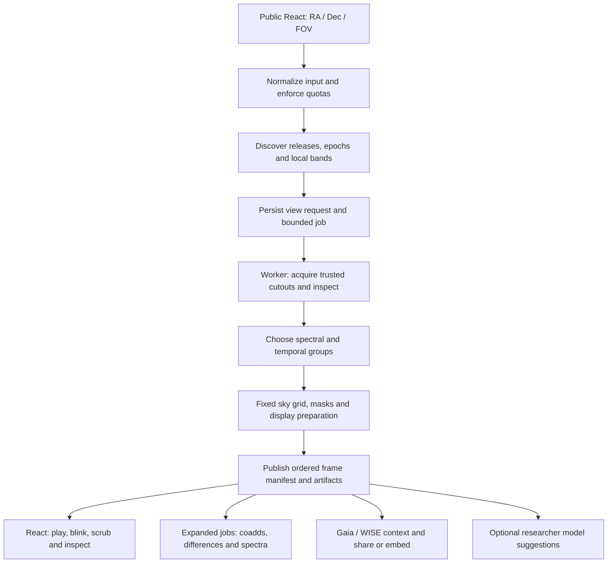

# Backend pipeline: coordinate-driven SPHEREx time viewing

Target design, 29 October 2026. Runtime now includes health/request validation, curated target catalog,
native/HTTPS job-persistence primitives and offline QR2/QR3 research inspection. The image pipeline
preparation stages below remain unimplemented; a separate input-acquisition worker now exists (step 3). The existing eleven-stage detection registry is a retained disabled legacy
specification; replace/version it deliberately when implementing viewer execution.

Step 2 update (31 October): `normalize_region` and `discover_products` now have standalone implemented
services/routes with immutable native/HTTPS persistence and real five-target checks. Available bands
at this stage mean whole-image SIA bounds, not local responses. Scientific image preparation remains future; bounded acquisition/structural validation is now implemented.
See [discovery implementation](discovery.md).

## Primary path

Single/no-epoch results return truthful data states. Movie assembly does not call detection/ranking.
Optional operations have separate eligibility checks and jobs; their failure does not destroy originals.

## Stage contracts and feature ownership

| Target stage | Owner | Inputs → outputs / boundary |
| --- | --- | --- |
| normalize_region | targets, views | RA/Dec units, FOV/dates → canonical ICRS request, limits and request hash |
| discover_products | observations, releases | Versioned source registry + region → immutable products, snapshots, completeness, dates/bands |
| plan_frames | views, bands, comparisons | Actual local coverage/time support → explicit temporal/spectral grouping, eligibility and resource estimate |
| acquire_inputs | cutouts, artifacts | Persisted trusted products/region → verified raw FITS keys, bytes and hashes |
| inspect_inputs | preprocessing | Release-aware HDUs → science/variance/masks/WCS/local response/PSF or ePSF with warnings |
| validate_frame_plan | comparisons, bands | Real downloaded metadata → revalidated band/time groups; estimates alone cannot authorize science |
| prepare_grid | registration | Sky-fixed grid + inputs → science/masks/variance/coverage and registration residuals; no target recentering |
| build_frames | views, bands, artifacts | Groups + display policy → chronological native/common-grid previews, WCS/grid/stretch/metadata |
| publish_view | views, analyses | Valid complete frame set → immutable view manifest with source/config/artifact lineage |

`plan_frames` estimates before expensive downloads; `validate_frame_plan` checks the real local
wavelength/quality evidence afterwards. Do not assume SIA's detector-wide band equals a local response.
Native inspection can remain available for insufficiently comparable products with explicit labels.

## Expanded branches

| Branch | Inputs → outputs | Gates |
| --- | --- | --- |
| D1–D6 composites | Per-detector bounded time groups → weighted mean/sum, count/variance/coverage/effective response | Consistent spectral support over compared epochs; mask propagation |
| Temporal coadd | Explicit selected epochs → separate stack plus contributor/time-span manifest | Motion-smearing/variable-flux warning; original movie retained |
| Signed difference | Approved pair → later-minus-earlier science/variance/mask/preview | Empirical registration, local response, calibration, background and PSF/ePSF validation |
| Spectrum | Coordinate/aperture + epoch group → available flux/error/wavelength/response samples and CSV | Validated photometry, units, proper motion/epoch, saturation/blend/missing-data checks |
| Survey context | Region + frame epoch → Gaia markers and WISE image/catalog layer | Source epoch/pm/frame/uncertainty and cross-survey attribution; isolated timeouts |
| Refresh/share/export | Canonical state or frozen view → refreshed version, URL state, embedded artifacts or export job | Frozen snapshots immutable, bounded refresh/encoding and no secrets in public links |
| Optional AI | Approved frames/package → supplied model hints, stamps and score semantics | Researcher goldens/parity, runtime limits, explicit enabled version; not a viewer dependency |

Coadds and spectra are not created from PNGs. Preserve calibrated arrays, masks and noise information.
PSF/background matching is operation-specific; a subtraction-grade fit need not block native inspection.
102 nominal bands do not mean every image/epoch samples all 102 channels at the selected coordinate.

## Worker, persistence and publication

- FastAPI validates, enforces quotas and transactionally accepts work; leased workers do network-heavy
  downloads/science/encoding. Reuse `analyses` infrastructure with typed job kinds and views relations.
- States: queued, running, succeeded, failed, cancel_requested, cancelled, with safe reason codes and
  per-stage completion. Data outcomes no_data/single_epoch/ready_for_animation are distinct from job state.
- Use atomic PostgreSQL claims, heartbeat/lease expiry, bounded attempts/deadline and checkpoints for cancel.
  An HTTPS DB gateway must preserve transaction semantics using explicit SQL functions, not multi-request races.
- Publish manifests only after artifact integrity and required relations pass. Cache by source/release,
  observing groups, region, response/mask/grid/stretch/config versions; never mutate a published view.
- Persist PostgreSQL metadata and external object files together. Local Space disk is a disposable cache;
  a separate durable worker/scheduler handles Space sleep. Backups restore referenced file generations.
- HF database egress is a milestone-zero decision: test supported transport or authenticated HTTPS
  repository adapter before relying on default psycopg/5432. See [deployment](deployment.md).

## Proposed resource and API migration

Viewer budgets: FOV 1–30′, default 5′; enclosing cone ≤0.5°; window ≤5 years; ≤100 discovery rows/page;
≤60 output frames/300 inputs per job; output edge ≤512 pixels; ≤128 MiB/input and ≤1 GiB/job.
These are proposals awaiting measurements, not changes to current request validation.
Beyond limits, require explicit bins/batches/pagination or reject; never silently shrink FOV/drop epochs.

Current legacy analysis limits remain 2–6 inputs and ≤5′, and current search radius ≤0.1°/730 days.
Implement new viewer schemas/routes/capability versioning and compatible migrations before changing
clients. The checked-in OpenAPI snapshot must reflect only actual app routes, not this target design.

Pure astronomy functions depend on arrays/units/metadata; feature services compose repositories/provider
adapters, and routers handle HTTP. Feature folders with planning READMEs are boundaries, not executors.

## Step 3 runtime boundary

[Durable input acquisition](views.md) implements submission/quota/idempotency, leases/fencing, trusted
FITS downloads, structural validation, local/S3 publication and bounded retention. The separate
worker is implemented; the detection registry remains disabled. Input success is not a registered movie.

## Step 4 implementation update

[view-v2 frame preparation](frame_preparation.md) now uses release-aware readers, strict masks,
fixed-grid reprojection/marginal variance, independent-reference residual checks, nominal/local-band
context, explicit bins and shared/per-frame previews. Additive cosmic_0005 adds prepared_frame_sets
and prepared_artifacts with fenced atomic raw/derived publication and bounded merged cleanup.
Existing v1 jobs are preserved. API and native worker images include SciPy/Pillow; the official
R7 catalog is packaged with source member hashes. Step 5 now adds [frozen movie delivery](movie_delivery.md) and a locally verified React/Aladin handoff.
Quantitative operations, cloud deployment and scientific target-recovery sign-off remain later gates.

## Steps 7–8 implementation update

[Derived jobs](derived_operations.md) now reuse shared admission/lease/cancellation/retention and the
raw/prepared artifact ledger. Additive cosmic_0007 adds guarded derivative admission, CSV publication
and typed coadd/spectrum/difference routes without resetting tables. Coadds and physical-unit sparse
spectra are implemented; actual frames-v1 differences remain blocked by missing quantitative science
acceptance. Diagnostic extraction is not validated spectrophotometry. Public cloud deployment and
scientific calibration/reference acceptance remain separate gates.

## Steps 9–10 implementation update — 2 November 2026

[Survey context and sharing](context_sharing.md) implement bounded Gaia DR3/AllWISE markers and W1/W2
images, actual epoch/WCS/quality/attribution, coordinate-state links, finite frozen IDs, reference iframe
delivery, explicit metadata refresh and durable GIF exports. `cosmic_0008` adds `release_refresh_checks`
for fenced per-query metadata checks; export jobs reuse the existing job/upload/retention protocol.
Optional context uses a bounded process-local cache; it never mutates a published SPHEREx movie.
New production React controls, external scheduler operation and public-host acceptance remain separate.
