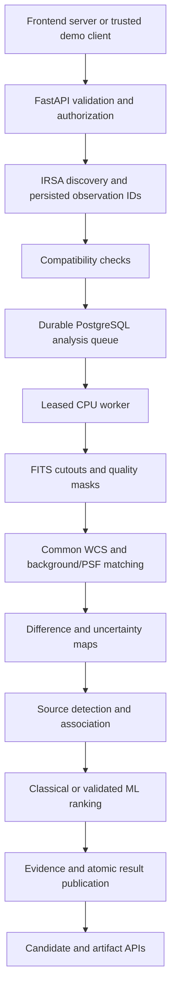

# Backend pipeline and module responsibilities

Baseline: 26 October 2026. This is the target execution architecture; the registry exists, but all
scientific executors are currently unimplemented. `python -m app.pipeline.cli` reports that honestly.

The main model is built and trained by the ML researcher and integrated by the backend developer.
The stages below are logical responsibilities: the supplied inference package may implement one or
several of them. Agree the input boundary and reuse the researcher's preprocessing/postprocessing;
do not implement duplicate transforms merely to match directory names. See [model handoff](model_handoff.md).

## End-to-end flow

Discovery is a precursor to analysis, not an expensive operation repeated inside every scientific stage.
The public viewer consumes image/evidence artifacts and JSON; it does not need FITS processing logic.

## Ordered scientific stages

| Order / registry name | Owner | Input | Output / required exit condition |
| --- | --- | --- | --- |
| 1 `validate_compatibility` | comparisons | Persisted ordered observations, sky region, versioned policy | Report verifying footprint, distinct epochs, known time scales, local wavelength/bandwidth, release/calibration and usable data |
| 2 `acquire_cutouts` | cutouts | Trusted provider references and cutout request | Immutable bounded downloads with checksums and source provenance |
| 3 `inspect_and_mask` | preprocessing | FITS cutouts and calibration references | Science/variance/flags/wavelength/WCS arrays; valid-pixel and coverage masks |
| 4 `register` | registration | Usable input arrays and celestial WCS | Common grid, footprint and residual alignment metrics; reject bad alignment |
| 5 `match_background_psf` | preprocessing | Registered images, variance, PSF/calibration | Matched background/flux response and PSF with transformations and uncertainty assumptions |
| 6 `difference` | differencing | Matched images and common validity mask | Signed difference, propagated variance/significance, coverage and correlation caveats |
| 7 `detect` | detection | Per-epoch images and residual maps | Source catalogs, centroids/uncertainty, residual segments, SNR/morphology features |
| 8 `associate` | association | Epoch detections, uncertainties and residual features | Candidate hypotheses: possible_motion, brightness_change, artifact, uncertain |
| 9 `rank` | ranking | Evidence stamps/features and immutable ranker version | Candidate scores, method, explanation codes and calibration reference if approved |
| 10 `build_evidence` | artifacts | Valid scientific outputs and candidate hypotheses | Original/aligned/difference previews, cutout stamps, overlays and JSON manifests |
| 11 `publish` | analyses | Complete validated output manifest | Atomic succeeded state and public artifact/candidate references |

Stage 8 may produce tentative sequence associations for >=3 observations in the advanced milestone.
Pair mode is exactly two observations. An analysis with no significant candidate is a valid successful
result, with quality/coverage evidence; it is different from a failed analysis.

## Discovery and compatibility details

- Query IRSA SIA2 by bounded sky region, time window and selected collection; parse status/errors as
  well as transport success. Save external product/release identifiers and server-assigned local IDs.
- Verify usable multi-epoch data early. A valid zero-result query proves endpoint access, not demo feasibility.
- Observation matching uses celestial footprints and epochs, not filename resemblance or pixel coordinates.
- Detector band labels alone do not establish equal wavelength at the selected sky location. Use local
  wavelength/bandwidth metadata and a reviewed overlap tolerance. Unknown metadata blocks scientific comparison.
- Prefer one reviewed release/calibration pipeline. Cross-release comparisons require explicit validation.
- Keep source time scale, original time representation, normalized UTC and conversion assumptions.
- Compatibility tolerances (time separation, wavelength overlap, registration RMS, usable coverage, PSF
  mismatch) are versioned research decisions. Establish values from real data before enabling analysis.

## Durable worker design (planned)

Use PostgreSQL for the MVP queue rather than introducing an additional broker before it is needed.
Enqueue and persist inputs in one transaction. A dedicated worker claims eligible jobs with
`FOR UPDATE SKIP LOCKED`, sets worker/lease/heartbeat metadata, and commits before CPU processing.
Do not keep a transaction or request connection open while downloading or processing images.

| State | Allowed transition | Meaning |
| --- | --- | --- |
| queued | running, canceled | Accepted and durably recorded |
| running | succeeded, failed, canceled | Worker lease held; stage metrics recorded |
| running with expired lease | queued through controlled recovery | Attempts bounded; partial artifacts not published |
| succeeded / failed / canceled | No in-place scientific rerun | New run references the same inputs/config as appropriate |

Required before worker acceptance:

- Atomic claims, lease renewal, worker death recovery, maximum attempts and retry classification.
- Idempotency key + request hash: same key/body returns existing job; different body returns 409.
  Scope keys to authenticated caller before multi-client use; the initial schema supports a single demo client.
- Stage checkpoints keyed by input checksums, config and code/model versions; never reuse solely by filename.
- Cancellation checked between stages and before publication; incomplete artifacts stay private.
- Transient provider errors may retry with backoff; incompatible data, invalid FITS and scientific QC
  failures are terminal until inputs/config change. A model exception must not silently change ranker.
- Classify safe messages such as `incompatible_wavelength`, `insufficient_coverage`, `registration_failed`,
  `invalid_fits`, `upstream_unavailable`, `model_unavailable`, `resource_limit` and `worker_timeout`.
- A worker image/entrypoint and Compose service are added when real executors exist. No idle/fake worker
  is supplied in this scaffold. Submission remains disabled until the queue, limits and stages work.

## Storage and reproducibility

PostgreSQL stores observations, run configs/status, ordered inputs, stages, models, candidates and
artifact metadata. File bytes live in local artifact storage for development or external object storage
for production. Use generated storage keys, immutable checksums and temporary-to-final publication.

Every result identifies source products/release, original epoch/time scale, sky region, local wavelength,
calibration/PSF references, transformations, masks, code version, dependency environment, pipeline/config
versions and ranker checksum. Previews also carry WCS/display transforms needed to overlay correctly.
Raw FITS and full precision data remain distinct from stretched/normalized browser PNGs.

## Resource boundaries

Initial request limits: radius <=0.1 degree; search window <=730 days; <=100 search rows;
2–6 distinct observations; cutout width <=5 arcmin; processing grid longest edge <=512 pixels;
download cap 128 MiB per object; provider timeout 30 seconds. These are engineering ceilings,
not guarantees that observations are scientifically compatible. Measure memory/time before production.

Before parsing, enforce byte limits; before allocating, inspect FITS dimensions/HDU count; for compressed
files, also bound decoded pixels and memory. Limit concurrent jobs, total job bytes, CPU time, retries and
per-client quotas. Default development concurrency is one scientific job when workers are implemented.

## Backend implementation boundary

Routers validate/authorize and call services. Feature services own scientific/domain rules and use
repositories/storage/provider adapters. Pipeline orchestration calls explicit stage interfaces.
Scientific functions accept arrays/metadata and return arrays/metrics; they should not depend on HTTP,
ORM sessions or an active model service. This enables synthetic image tests and reproducible notebooks.
