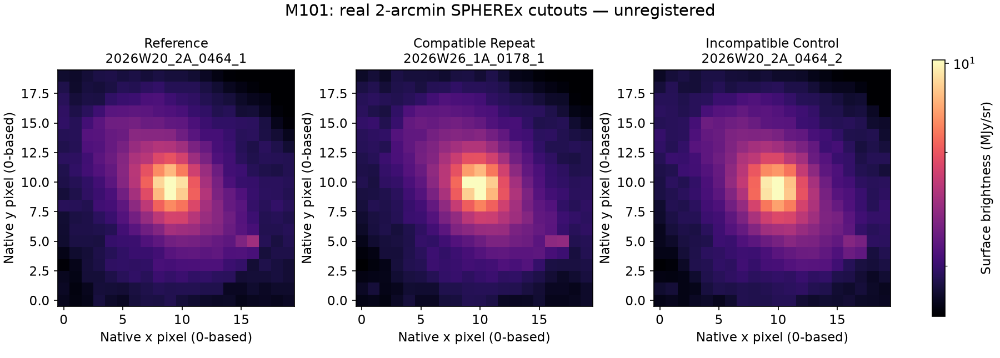

# Milestone 1: real data and challenge feasibility

Historical capture, 26 October 2026. The user supplied the full challenge description on 29 October:
objective/considerations are now mapped in [the revised plan](../../todo_plan.md) and
[coverage matrix](../challenge_alignment.md). The measurements below are preserved; they are not
evidence for the five required target tests. The old brief-pending statements below describe capture-time
access limits. Submission rules and scientific validation still need separate verification.

Verified 26 October 2026. **GO for the backend discovery slice:** three real public IRSA
SPHEREx QR2 cutouts were downloaded, inspected and pinned. One repeat pair passes the
versioned development preflight; a same-detector negative control fails. No organizer-supplied
files, paid API, account, API key, trained model or GPU was needed for this probe.

This milestone proves that real inputs exist and can be inspected. It does not demonstrate
motion detection, empirical image registration, scientific calibration equivalence or model accuracy.
Complete challenge rules remain an external verification item because the full brief was inaccessible.

## Inspect the evidence

- [Executed notebook](data_path_feasibility.ipynb): real image previews, wavelength comparison and results.
- [Pinned manifest](data_path_manifest.json): exact discovery/cutout URLs, retrieval times, byte counts,
  SHA-256, source fields, footprints and immutable product identifiers.
- [Measured report](data_path_report.json): per-HDU inspection, flags, PSF selection, compatibility checks,
  environment and resource measurements. Numeric results below come from this report.
- [Compatibility policy](compatibility_policy_v1.md): equations, thresholds, rationale and validation limits.
- [Resource register](resources.md): independent public resources, interpretation and attribution guidance.
- [Known-mover metadata receipt](known_mover_resource.json): 259 real 3I/ATLAS table rows verified separately.

## Real sample and decision

Target: M101 central control field, ICRS RA **210.80227°**, Dec **54.34895°**, size **2 arcmin**.
This is a real structured sky field for development, not a certified source-free or nonvariable field.

| Role | Observation ID (all detector D2) | Mid-exposure UTC | Local wavelength / FWHM (µm) | Usable pixels |
| --- | --- | --- | --- | --- |
| Reference | `2026W20_2A_0464_1` | 2026-05-17 10:54:42.815 | 1.4203148 / 0.0342262 | 399/400 |
| Compatible repeat | `2026W26_1A_0178_1` | 2026-06-22 20:22:30.749 | 1.4206877 / 0.0342362 | 397/400 |
| Incompatible control | `2026W20_2A_0464_2` | 2026-05-17 10:56:51.746 | 1.4543874 / 0.0354480 | 375/400 |

All are collection `spherex_qr2`, processing family `l2b-v25`, pipeline **6.5.7**, reference catalog
`SPHEREx_RefCat_v0.73`. Full processing tokens differ (`l2b-v25-2026-140` and
`l2b-v25-2026-180`) and are preserved rather than conflated. The cutout headers do not enumerate
every calibration asset; matching family/version is a development gate, not a calibration certificate.

The repeat is **36.394305 days** later. WCS mapping gives **90.25%** geometric overlap and
**353/400 = 88.25%** common usable reference pixels under a conservative four-neighbor mask.
Across those pixels the minimum local FWHM-interval overlap proxy is **98.9222%**. The central
wavelength shift is **0.010894 bandwidths**. These pass the development policy.

The adjacent exposure has a central shift of **0.995511 bandwidths**, only **2.2338%** central
interval overlap, **1.9340%** minimum local interval overlap and **79%** common usable coverage.
It fails three gates. A common detector label is insufficient to select a scientific pair.



## What was inspected

Each FITS file contains PRIMARY plus IMAGE, FLAGS, VARIANCE, ZODI, PSF and WCS-WAVE.
The native science grids are 20×20; IMAGE is MJy/sr and VARIANCE is its squared unit.
All science samples are finite; explicit positive-variance and quality masks reduce usable coverage.
The source timestamps declare UTC; original MJD and ISO strings are retained without invented precision.
Celestial WCS uses the original SIP distortion. The alternate wavelength WCS uses the WCS-WAVE
lookup without applying celestial SIP to the spectral coordinates.

All 400 pixels in each image carry `MP_SOURCE`. That is informational, so masking every nonzero
flag would erase the target. `MP_FULLSAMPLE` is also retained; other documented bits and unknown
bits are rejected by the conservative development mask. Flag counts overlap and are not additive.
The repeat includes two persistence-flagged pixels and one halo pixel. The negative includes transient,
nonfunctional and halo flags. The policy and tests preserve these distinctions.

The PSF extension is a 121×101×101 cube. The inspector maps the target back to parent-detector
coordinates and selects the nearest documented PSF-zone center, preserving its plane checksum.
Pipeline 6.5.7 is beyond the documented PSF-header-error range. This checks availability, not PSF matching.
Current [IRSA ePSF guidance](https://caltech-ipac.github.io/irsa-tutorials/spherex-psf/)
recommends the newer ePSF for scientific work. QR2's older PSF remains a material limitation:
validate a QR3/ePSF pair or the documented newer ePSF route before scientific candidate claims.

ZODI is present but was not subtracted or fitted. No subtraction/significance map was produced.
The raw files have no FITS CHECKSUM cards in this sample; SHA-256 pins their downloaded bytes.

## Discovery provenance and sampling limits

SIA queries used `POS=CIRCLE 210.80227 54.34895 0.001`, `MAXREC=150` and separate QR2/QR3
collections. The QR2 snapshot contains 150 rows and **QUERY_STATUS=OVERFLOW**: it is incomplete,
unordered evidence of existence, not a complete cadence/coverage inventory. QR3 returned zero rows
with status OK for this exact request; this does not establish general QR3 unavailability.
The archived XML responses retain original bytes. Their receipt time uses the original downloaded
file's modification timestamp because the exploratory request start time was not recorded.
Cutout retrieval timestamps were explicitly recorded at download completion.

Selection was: inspect the bounded D2 sample, measure local wavelengths in real cutouts, retain a
similar-wavelength repeat and a nearby incompatible exposure. Additional candidate requests were
exploratory; a truncated download was excluded and is not included in any manifest or measurement.
The first spectral response probe is deliberately a FWHM interval proxy. Use the calibration
resource register for full response functions and pipeline calibration assets at later milestones.

The notebook executed successfully with saved outputs, and its exported figures were visually checked.
HTML export succeeded, but full browser inspection was blocked by the computer tool's inability to
verify the Windows browser URL. Open the local HTML preview after the build command below to
complete that presentation check; this does not affect the executed numerical results.

## Reproduce

From `backend`, reuse/create a Python 3.12 environment and install:

```powershell
.\.venv\Scripts\python -m pip install -e ".[dev,research]"
```

Then from the repository root:

```powershell
# Fetch only missing files; verify exact pinned bytes, inspect FITS and regenerate the report.
.\backend\.venv\Scripts\python scripts/prove_spherex_data_path.py --download
# Subsequent runs are entirely offline.
.\backend\.venv\Scripts\python scripts/prove_spherex_data_path.py
# Rebuild and execute every notebook cell, save outputs and export a local HTML preview.
.\backend\.venv\Scripts\python scripts/build_data_feasibility_notebook.py
# Optional fresh bounded discovery; writes a new timestamped capture under var/, not the fixtures.
.\backend\.venv\Scripts\python scripts/capture_spherex_metadata.py
```

Downloads are sequential, HTTPS/host constrained, byte/time bounded and published atomically.
The probe accepts only its local reviewed manifest; it is not an endpoint accepting user URLs.
A changed checksum stops reproduction for source review rather than silently replacing the pin.
Historical cutouts may be reprocessed or retired by IRSA; retain your permitted local cache and
record a new reviewed version if upstream bytes change. The full production adapter/retry/cache,
job quotas and artifact lifecycle remain later plan steps.

## Resource measurements and deployment implications

Each 20×20 cutout is **5,063,040 bytes** because the PSF cube dominates file size. Three cost
**15,189,120 bytes** (about 14.49 MiB); the positive pair costs about 9.66 MiB.
Original individual downloads took **13.517–19.485 seconds** on this connection. Offline inspection
of three files and two comparisons took about **1.75 seconds**, with maximum *sampled* process RSS
about **67.24 MiB** on this Windows/Python environment. See the report for exact versions and CPU
count. RSS was sampled around operations; it is not a true peak or an incremental allocation measure.

This is a small CPU-only feasibility measurement, not a benchmark for large images, reprojection,
PSF fitting, concurrent workers or researcher-supplied inference. Do not derive a Hugging Face hardware
guarantee from it. Keep FITS out of Git/PostgreSQL, cache repeat downloads and persist model/artifact
storage externally as planned. Research-only notebook/plot dependencies are optional and are not
installed into the production Docker image by this change.

## Challenge path and next handoff

The backend can discover real inputs, validate comparability and later serve original/aligned images,
candidate evidence and score meaning to the frontend team's public comparison viewer. This supports
the available official challenge summary. It does not certify the full brief, current submission rules
or judging requirements; the direct challenge page returned 502 during research.

IRSA's [3I/ATLAS resource](https://irsa.ipac.caltech.edu/data/SPHEREx/docs/comet3iatlas/)
provides predicted exposure positions and a verified 259-row metadata table. Its `access_url` values
are DataLink responses, not direct FITS; resolve links before downloading. Low SNR and extended coma
make this a researcher-reviewed follow-up resource, not an assumed point-source positive benchmark.
No mover was detected or validated in this milestone.

Next: implement **step 2**, a bounded SIA discovery adapter with overflow/error handling and persisted
observation identity. Preserve the offline helpers and negative fixture for regression tests. Before
scientific release the researcher must review mask/response/PSF and motion-validation assumptions.
The frontend, ML training and live discovery/execution API behavior are unchanged. No commit or push.
