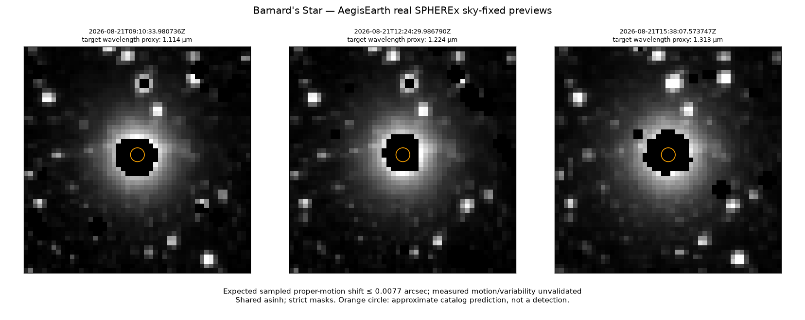
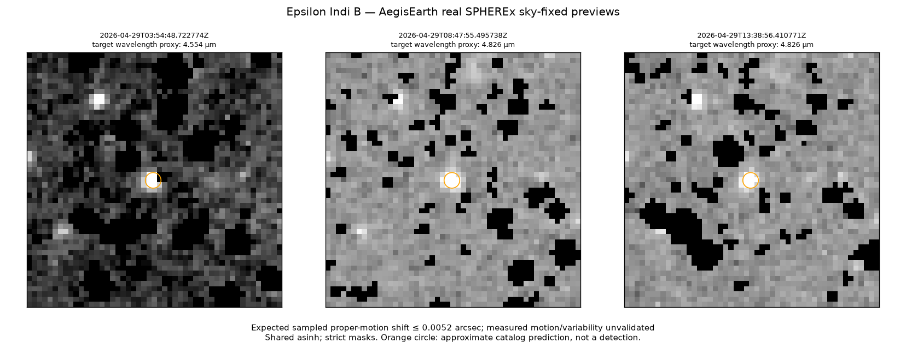
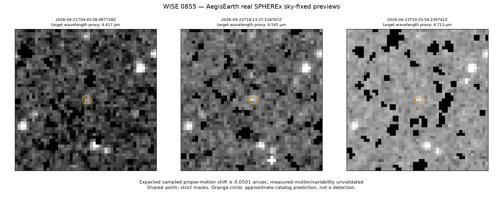
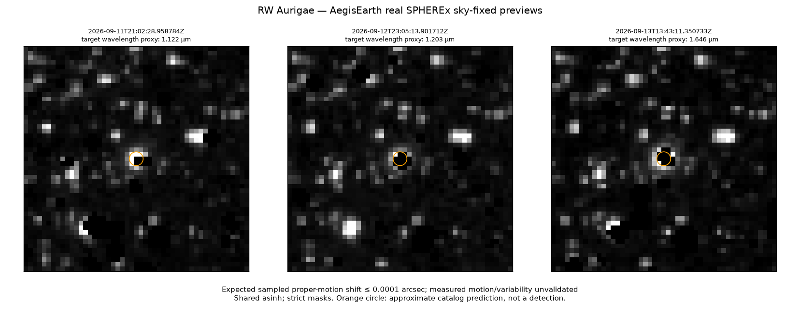
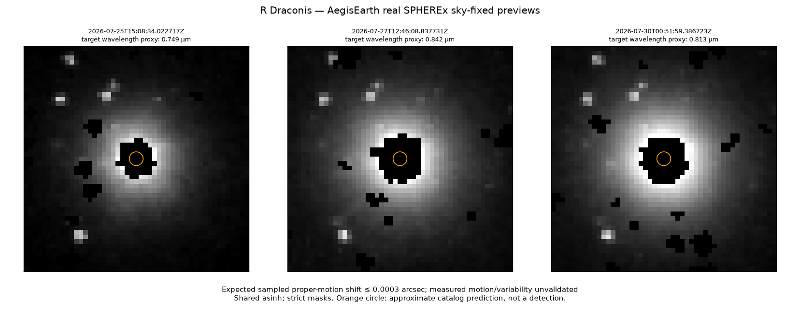

# AegisEarth — step 6 target validation

Run `b40e46de-ec7b-43ea-83fb-5da354592865`; UTC execution receipt: 2026-11-01T14:38:46.578927+00:00.

Backend engineering validation and source diagnostics are executed. Scientific reviewer: **not supplied**.
Frontend handoff acceptance in the production UI is user-confirmed (1 November 2026); the browser receipt here tests the local reference player.

## Executed outcomes

| Target | Live case outcomes | Max baseline: live / pinned | Max expected shift: live / pinned | Scientific finding |
| --- | --- | --- | --- | --- |
| [Barnard's Star](barnards-star.json) | catalog_prediction: ready_for_animation | 0.269139 / 9.299146 days | 0.007658 arcsec / 0.264611 arcsec | Bright-source flags prevent a target-aperture motion measurement |
| [Epsilon Indi B](epsilon-indi-b.json) | catalog_prediction: no_data; archive_band_followup: ready_for_animation | 0.405645 / 367.535096 days | 0.005202 arcsec / 4.713470 arcsec | System B identity retained; Ba/Bb resolution unclaimed |
| [WISE 0855](wise-0855.json) | catalog_prediction: ready_for_animation; supplied_coordinate: ready_for_animation | 2.243001 / 181.796310 days | 0.050059 arcsec / 4.057278 arcsec | Long-wave aperture signal is diagnostic; association/detection and motion unvalidated |
| [RW Aurigae](rw-aurigae.json) | catalog_prediction: single_epoch; archive_band_followup: ready_for_animation | 1.694935 / 4.958177 days | 0.000100 arcsec / 0.000293 arcsec | Shared stretch retained; flagged pixels/response prevent calibrated variability inference |
| [R Draconis](r-draconis.json) | catalog_prediction: ready_for_animation; archive_band_followup: ready_for_animation | 6.177758 / 15.817174 days | 0.000364 arcsec / 0.000933 arcsec | Bright-source masking/response differences prevent calibrated variability inference |

An empty bounded/overflowing search is not proof of no archive coverage. Single-epoch cases do not loop.
Whole-image BAND follow-ups reduce unrelated detector rows under the 40-row SIA cap; they do not guarantee local response equivalence.
All initial and follow-up outcomes are retained. The 27 earlier pinned cutouts add longer-baseline, alternate-epoch evidence without being relabeled as fresh padded API jobs.

## Target-specific evidence

### Barnard's Star

[Full receipt](barnards-star.json); [6 prior native inputs](../../research/target_feasibility/cutouts_manifest.json).



**catalog_prediction** — succeeded; view `5b624be2-bd3b-46b7-8076-7cfc7845fd19`; outcome `ready_for_animation`.

- 2026-08-21T09:10:33.981Z: target wavelength proxy 1.1135 µm; aperture usable 0.0%; contrast SNR proxy unavailable (mask/coverage); MP_OVERFLOW=4; MP_BLOOM=7.
- 2026-08-21T12:24:29.987Z: target wavelength proxy 1.2235 µm; aperture usable 0.0%; contrast SNR proxy unavailable (mask/coverage); MP_OVERFLOW=6; MP_BLOOM=7.
- 2026-08-21T15:38:07.574Z: target wavelength proxy 1.3132 µm; aperture usable 0.0%; contrast SNR proxy unavailable (mask/coverage); MP_OVERFLOW=7; MP_BLOOM=8.

### Epsilon Indi B

[Full receipt](epsilon-indi-b.json); [5 prior native inputs](../../research/target_feasibility/cutouts_manifest.json).



Catalog system identity `* eps Ind B` is separated from `* eps Ind` by 402.30 arcsec at the catalog positions. This does not resolve Ba and Bb.

**catalog_prediction** — succeeded; view `ba8d9a25-df46-4480-bad4-a052d7f230e4`; outcome `no_data`.


**archive_band_followup** — succeeded; view `fdc5cc2f-2b9f-4395-9a18-b80a4c69ffa3`; outcome `ready_for_animation`.

- 2026-04-29T03:54:48.723Z: target wavelength proxy 4.5541 µm; aperture usable 100.0%; contrast SNR proxy 54.831; none of the listed bright-artifact flags.
- 2026-04-29T08:47:55.496Z: target wavelength proxy 4.8263 µm; aperture usable 100.0%; contrast SNR proxy 59.756; none of the listed bright-artifact flags.
- 2026-04-29T13:38:56.411Z: target wavelength proxy 4.8264 µm; aperture usable 100.0%; contrast SNR proxy 59.018; none of the listed bright-artifact flags.

### WISE 0855

[Full receipt](wise-0855.json); [6 prior native inputs](../../research/target_feasibility/cutouts_manifest.json).



**catalog_prediction** — succeeded; view `7f14633a-be0b-4ec0-a310-ced1b60d910f`; outcome `ready_for_animation`.

- 2026-04-21T04:45:58.988Z: target wavelength proxy 4.4174 µm; aperture usable 100.0%; contrast SNR proxy 4.966; none of the listed bright-artifact flags.
- 2026-04-22T18:13:37.519Z: target wavelength proxy 4.5446 µm; aperture usable 100.0%; contrast SNR proxy 7.133; none of the listed bright-artifact flags.
- 2026-04-23T10:35:54.240Z: target wavelength proxy 4.7127 µm; aperture usable 100.0%; contrast SNR proxy 4.525; none of the listed bright-artifact flags.

**supplied_coordinate** — succeeded; view `840c4f28-32c2-4e20-892a-8d1a7d2931c4`; outcome `ready_for_animation`.

- 2026-04-21T04:45:58.988Z: target wavelength proxy 4.4174 µm; aperture usable 100.0%; contrast SNR proxy 4.966; none of the listed bright-artifact flags.
- 2026-04-22T18:13:37.519Z: target wavelength proxy 4.5446 µm; aperture usable 100.0%; contrast SNR proxy 7.133; none of the listed bright-artifact flags.
- 2026-04-23T10:35:54.240Z: target wavelength proxy 4.7127 µm; aperture usable 100.0%; contrast SNR proxy 4.525; none of the listed bright-artifact flags.

The challenge seed retains its unknown epoch. Both seed and catalog-prediction fields are executed; neither position is silently assigned an observing epoch. The 4-5 µm aperture values are not a validated identification or a calibrated detection limit. No formal nondetection is asserted.

### RW Aurigae

[Full receipt](rw-aurigae.json); [4 prior native inputs](../../research/target_feasibility/cutouts_manifest.json).



**catalog_prediction** — succeeded; view `38fa813b-bdf8-4e80-b4d5-3336b4b6574d`; outcome `single_epoch`.

- 2026-09-11T21:02:28.959Z: target wavelength proxy 1.1217 µm; aperture usable 85.7%; contrast SNR proxy unavailable (mask/coverage); MP_OVERFLOW=1.

**archive_band_followup** — succeeded; view `9a785411-2291-4c4c-8dc4-9d4523ecc73e`; outcome `ready_for_animation`.

- 2026-09-11T21:02:28.959Z: target wavelength proxy 1.1217 µm; aperture usable 85.7%; contrast SNR proxy unavailable (mask/coverage); MP_OVERFLOW=1.
- 2026-09-12T23:05:13.902Z: target wavelength proxy 1.2032 µm; aperture usable 28.6%; contrast SNR proxy unavailable (mask/coverage); MP_OVERFLOW=1; MP_BLOOM=5.
- 2026-09-13T13:43:11.351Z: target wavelength proxy 1.6462 µm; aperture usable 28.6%; contrast SNR proxy unavailable (mask/coverage); MP_OVERFLOW=1; MP_BLOOM=5.

### R Draconis

[Full receipt](r-draconis.json); [6 prior native inputs](../../research/target_feasibility/cutouts_manifest.json).



**catalog_prediction** — succeeded; view `87e6c9c9-b9bc-495d-a54f-bf31a35c0aa2`; outcome `ready_for_animation`.

- 2026-07-25T15:08:34.023Z: target wavelength proxy 0.7490 µm; aperture usable 0.0%; contrast SNR proxy unavailable (mask/coverage); MP_OVERFLOW=4; MP_BLOOM=7.
- 2026-07-27T12:46:08.838Z: target wavelength proxy 0.8416 µm; aperture usable 0.0%; contrast SNR proxy unavailable (mask/coverage); MP_OVERFLOW=7; MP_BLOOM=7.
- 2026-07-30T00:51:59.387Z: target wavelength proxy 0.8134 µm; aperture usable 0.0%; contrast SNR proxy unavailable (mask/coverage); MP_OVERFLOW=7; MP_BLOOM=7.

**archive_band_followup** — succeeded; view `ce6c6eff-890c-4185-8a42-6adf32eaf59e`; outcome `ready_for_animation`.

- 2026-07-25T15:08:34.023Z: target wavelength proxy 0.7490 µm; aperture usable 0.0%; contrast SNR proxy unavailable (mask/coverage); MP_OVERFLOW=4; MP_BLOOM=7.
- 2026-07-29T15:15:30.621Z: target wavelength proxy 0.7949 µm; aperture usable 0.0%; contrast SNR proxy unavailable (mask/coverage); MP_OVERFLOW=4; MP_BLOOM=5.
- 2026-07-31T19:24:32.342Z: target wavelength proxy 0.8649 µm; aperture usable 0.0%; contrast SNR proxy unavailable (mask/coverage); MP_OVERFLOW=7; MP_BLOOM=7.

## Interpretation and limits

Expected shifts use the catalog pmRA*cos(dec), pmDec and actual FITS observing times. The scalar proper-motion error proxy lacks the catalog covariance, parallax/perspective and observer ephemeris; it is not a complete astrometric error budget.
Each pair records expected displacement/native pixel size, header PSF FWHM (explicitly unvalidated), reference-registration residual availability and target-exclusion checks. Sampling near 6 arcsec is not an angular-resolution or detection threshold. Missing measured motion remains null.
Aperture contrast uses a full strict-mask 1.5-pixel aperture and median 4-10-pixel annulus. It preserves intensity scaling, uses diagonal-variance proxies only, and omits covariance, PSF/aperture/response corrections and source-association validation. A high proxy value is not discovery evidence.
Signed differences, calibrated spectra/photometry, Gaia/WISE context, refresh/share/embed and optional ML remain later plan slices. These unsupported operations are not scored as successful tests. The viewer remains independent of them.

## Reproduction and sources

```powershell
.\backend\.venv\Scripts\python scripts/validate_challenge_targets.py
.\backend\.venv\Scripts\python scripts/render_target_validation.py
.\backend\.venv\Scripts\python scripts/report_target_validation.py
cd handoff/player
npm run verify:targets
```

Start the isolated foundation and reference player first. Re-runs create a new receipt generation; input checksums, catalog/config hashes, library versions and unexpired artifact IDs are recorded. Large FITS and browser screenshots stay under ignored var/.

[Aggregate run receipt](summary.json), [browser evidence](browser.json), [five-target protocol](../../target_validation.md).
Primary scientific references: [SPHEREx instrument/sampling](https://spherex.caltech.edu/page/instrument), [IRSA products and PSF caveats](https://caltech-ipac.github.io/spherex-archive-documentation/spherex-data-products/), [IRSA photometry caveats](https://irsa.ipac.caltech.edu/onlinehelp/spherex/spherex/sp.html), [Astropy position/velocity assumptions](https://docs.astropy.org/en/stable/coordinates/velocities.html).

No model training, scientific reviewer approval, public deployment or confirmed motion/variability is asserted.
